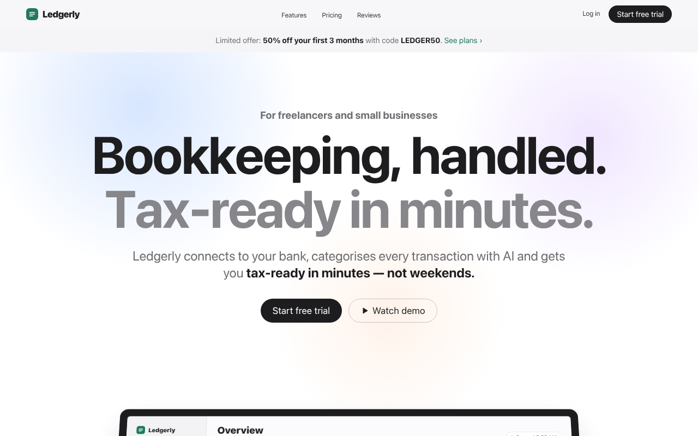
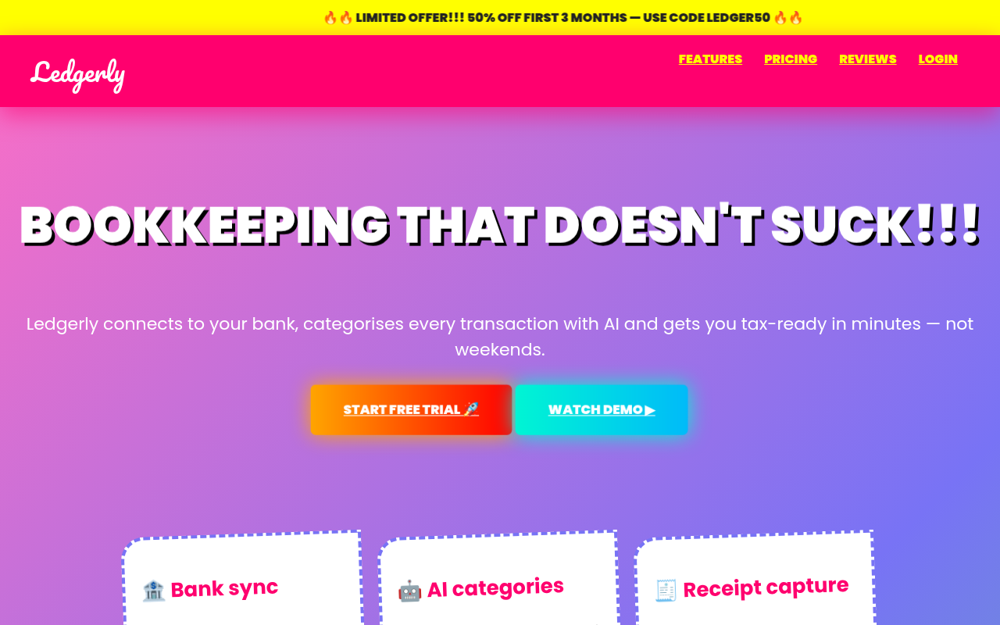
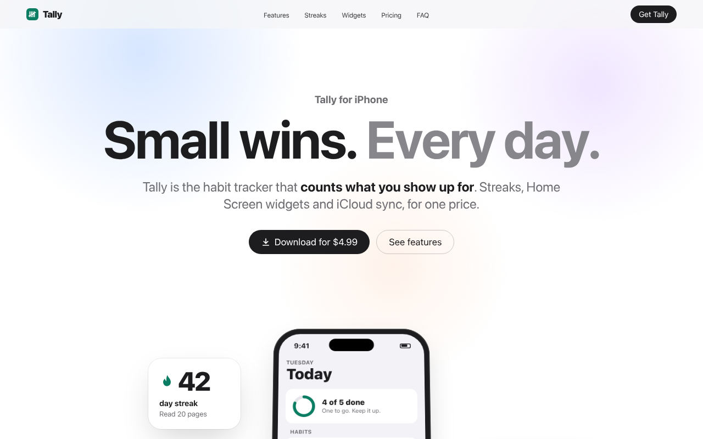
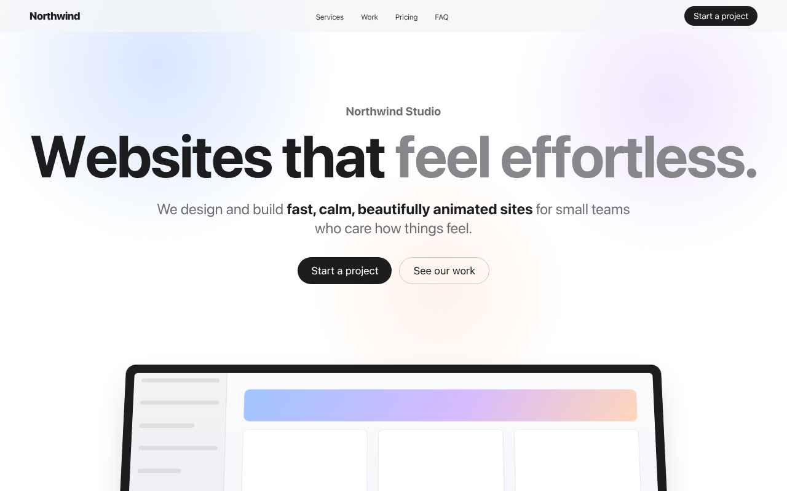

# apple-style-web

**A Claude skill for building websites that feel like apple.com.** Quiet white pages, huge tight headlines, one accent colour, frosted-glass navigation, spring physics, scroll reveals and draggable card rails. It is fast, accessible and SEO-clean out of the box.

The skill packages a design system measured from apple.com's live CSS together with production code from the [KelperZone](https://kelperzone.com) redesign. Claude gets the numbers (colours, type scale, spacing, glass recipes, spring presets), the page structures, ready-made components and a ship checklist, so it gets the look right on the first try.



---

## Contents

- [What it does](#what-it-does)
- [Examples](#examples)
- [Install](#install)
- [Use it](#use-it)
- [The detailed prompt](#the-detailed-prompt)
- [What's inside](#whats-inside)
- [Customise it](#customise-it)
- [Test it](#test-it)
- [Benchmark](#benchmark)
- [FAQ](#faq)
- [Credits and legal](#credits-and-legal)

---

## What it does

With the skill installed, Claude picks it up automatically whenever you ask for an "Apple-like", "premium", "clean and minimal", "high-end" or "polished" website, or ask it to make an existing site feel more expensive. You don't have to name the skill. Claude then works through these steps:

1. **Brief.** It pins down the brand, accent colour, pages, real visuals and stack, choosing sensible defaults instead of asking you lots of questions.
2. **Tokens.** It installs one CSS file of design values: `#f5f5f7` bands, `#1d1d1f` ink, the type scale, radii, glass recipes and easing curves.
3. **Page structure.** Each section holds one idea: a headline, one line, one visual and at most two buttons.
4. **Components.** It uses a glass navbar that becomes a floating pill on scroll, two-tone headings, a bento grid, card rails, tilt cards, an accordion and a pricing estimator.
5. **Motion.** Interruptible springs, entrances that play once, headline reveals that never split a word, loops that pause offscreen, and full support for reduced motion.
6. **Build and verify.** It checks phone width, keyboard use, reduced motion, layout shift, SEO tags, structured data and Lighthouse scores.

It works with **React + Tailwind v4 + `motion`**, with **Next.js**, or as **plain HTML/CSS/JS with no build step**.

## Examples

All of these were built by Claude with the skill during testing. None was edited by hand.

| Before (the input) | After (with the skill) |
|---|---|
|  |  |

| iOS app landing page, single HTML file | Bundled no-build starter page |
|---|---|
|  |  |

## Install

Choose the option that matches how you use Claude.

### Claude Code: plugin (recommended)

This repo is also a plugin marketplace. In Claude Code:

```text
/plugin marketplace add Axoineo/apple-style-web
/plugin install apple-style-web@apple-style-web
```

Run `/plugin marketplace update apple-style-web` to pick up new versions later.

### Claude Code: copy the skill folder

For every project on your machine:

```bash
git clone https://github.com/Axoineo/apple-style-web.git
```

```bash
cp -r apple-style-web/plugins/apple-style-web/skills/apple-style-web ~/.claude/skills/
```

For a single project only, copy it into that project's `.claude/skills/` folder instead:

```bash
mkdir -p .claude/skills && cp -r apple-style-web/plugins/apple-style-web/skills/apple-style-web .claude/skills/
```

### Claude.ai and the Claude desktop app

1. Download `apple-style-web.skill` from the [latest release](https://github.com/Axoineo/apple-style-web/releases/latest).
2. In Claude, open **Settings**, find **Skills** (under Capabilities), choose to upload a skill and select the file. A `.skill` file is a zip; if your Claude asks for `.zip`, rename it.
3. Make sure code execution / file creation is turned on so Claude can write the site's files.

### Check it's installed

Ask Claude: *"What skills do you have for building websites?"* It should list `apple-style-web`. In Claude Code, it also appears in the skills list.

## Use it

Just describe the site. Some prompts that trigger the skill:

```text
Make a landing page for my habit tracker app Tally. I want it to feel like apple.com.
iOS only, $4.99 one-time, features: streaks, widgets, iCloud sync. Single HTML file is fine.
```

```text
Build the homepage for my interior design studio in React + Vite + Tailwind v4 + motion.
High-end and calm, with a draggable gallery of past projects.
```

```text
Here's our current landing page (index.html). It looks cheap. Redesign it so it feels
premium, like an Apple product page. Keep all the content.
```

```text
Our navbar animation feels janky and the hero text flashes on load. Fix it the Apple way.
```

Tips for the best results:

- **Give it real visuals.** Screenshots of your product or past work make the biggest difference. Without them, Claude builds device-framed mockups in CSS that you can swap later.
- **Name one accent colour**, or let Claude pick a calm one.
- **Ask it to verify in a browser** if your setup has one. The skill ends with a checklist and reports anything it couldn't check.

## The detailed prompt

[`PROMPT.md`](PROMPT.md) is a fill-in-the-blanks brief that captures the whole design system in one message. Use it:

- with the skill, to give Claude complete business details up front;
- **without** the skill, in Lovable, Cursor, v0, Bolt or any other AI builder, where it stands in for the skill.

Fill in the `[brackets]`, delete the pages you don't need, and paste it in.

## What's inside

```text
apple-style-web/
├── .claude-plugin/marketplace.json        # makes the repo a Claude Code marketplace
├── plugins/apple-style-web/
│   ├── .claude-plugin/plugin.json
│   └── skills/apple-style-web/            # ← the skill itself
│       ├── SKILL.md                       # workflow, reading budget, 10 taste rules
│       ├── references/
│       │   ├── tokens.md                  # colour, type scale, spacing, radii, glass, easing
│       │   ├── motion.md                  # springs, reveals, no-flash pattern, gestures, a11y
│       │   ├── layouts.md                 # page anatomies + 14 section recipes
│       │   ├── components.md              # buttons, nav, cards, device frames, forms…
│       │   └── checklist.md               # look, motion, responsive, perf, a11y, SEO
│       ├── assets/
│       │   ├── react/                     # drop-in components (see table below)
│       │   └── html/starter.html          # complete no-build one-pager
│       └── evals/                         # 3 test cases for `claude plugin eval`
├── PROMPT.md                              # the detailed standalone prompt
└── docs/images/                           # screenshots used in this README
```

**React components** in `assets/react/`. They have no Tailwind dependency and only need `react` and `motion`:

| File | What it does |
|---|---|
| `tokens.css` | All design tokens, plus glass, buttons, reveals, the nav bar, aurora glow, edge glow, scrollbars and reduced-motion rules |
| `springs.ts` | Spring presets `ui`, `surface`, `flick`, `pill` and `pop` (bounce + duration), plus easing curves |
| `GlassNav.tsx` | 52px translucent bar that becomes a floating glass pill, with a scroll-progress hairline and an accessible mobile menu |
| `TextReveal.tsx` | Per-character heading reveal that keeps words whole, blurs per word and supports two-tone headings |
| `MotionReveal.tsx` | Fade-up-and-focus section entrance that plays once |
| `SnapRail.tsx` | Draggable rail: 1:1 drag, rubber-band edges, flick projection, keyboard and trackpad support |
| `Tilt.tsx` | Mouse-only 3D lean on springs with an edge glow that follows the cursor |
| `AuroraBackdrop.tsx` | Soft pastel CSS glow behind heroes, paused offscreen |
| `ScrollActivity.tsx` | Overlay scrollbars that show only while scrolling |
| `useReducedMotion.ts`, `useOnScreen.ts` | Hydration-safe reduced-motion hook, and a hook that pauses work offscreen |
| `head-script.html` | Inline `<head>` snippet that stops text flashing visible and then re-animating on load |

## Customise it

- **Brand colour.** Change `--accent` in `tokens.css`. Keep it at 4.5:1 contrast or better on white.
- **House rules.** Add your own constraints to the "Taste rules" in `SKILL.md`, for example "always use our logo SVG" or "buttons are the accent colour".
- **Your own components.** Drop them into `assets/react/` and add a row to the table in `SKILL.md` so Claude knows they exist.
- Keep the measured numbers (type scale, radii, glass recipes) unless you have a reason to change them. Small deviations are what make copies look cheap.

## Test it

The skill ships with three test cases in `evals/`: an iOS app landing page, a React studio homepage, and a redesign of a deliberately cheap-looking page. Each comes with graders. With Claude Code v2.1.269 or later, run them from the skill folder:

```bash
cd plugins/apple-style-web/skills/apple-style-web
```

```bash
claude plugin eval . --allow-tools Write,Edit,Bash --scaffold
```

This runs each case with and without the skill and writes a report to `evals/results/`. These are real, billed model runs.

## Benchmark

These are from the first test round, one run per configuration, so treat them as indicative. "Without" means the same Claude model with no skill installed.

| Test | With skill | Without |
|---|---|---|
| Tally iOS landing page | 12/12 | 8/12 |
| Ledgerly redesign | 12/12 | 9/12 |
| Maison Clair React homepage | 11/11 | 8/11 |
| **Pass rate** | **100%** | **72%** |

Claude is already good at the basics (system fonts, glass nav, reduced motion), so both versions passed those checks. The skill made the difference on the signature details:

| Check | With skill | Without |
|---|---|---|
| Two-tone headings | 3/3 | 2/3 |
| Bold key phrase in the hero paragraph | 3/3 | 0/3 |
| Navbar becomes a floating pill on scroll | 3/3 | 0/3 |
| Canonical and Open Graph tags | 3/3 | 0/3 |

The trade-off is cost: with the skill, runs used about 1.8× the tokens. `SKILL.md` now includes a reading budget to reduce this.

## FAQ

**Is this an Apple template?** No. It borrows Apple's *discipline* (restraint, type scale, motion physics) and none of its brand. The skill explicitly forbids Apple's logo, product images, copy, icons and the SF Pro webfont.

**Why not use SF Pro?** Apple licenses SF Pro for its own platforms, not for websites. The skill uses the system font stack, which shows SF Pro on Apple devices legally and falls back to Inter elsewhere.

**Does it work without React?** Yes. `assets/html/starter.html` is a complete page in plain HTML/CSS/JS, with the same nav, reveals, rail physics and tilt cards and no build step.

**Will it work in Lovable / Cursor / v0?** Those tools don't load Claude skills, so use [`PROMPT.md`](PROMPT.md) there instead.

**Can I use it for client work?** Yes. It's MIT licensed.

## Credits and legal

- The design system was measured from publicly visible styles on apple.com and refined in the KelperZone redesign.
- Not affiliated with, endorsed by or sponsored by Apple Inc. Apple, apple.com, iPhone, MacBook, iCloud and SF Pro are trademarks of Apple Inc.
- The example brands in the screenshots (Ledgerly, Tally, Northwind, Maison Clair) are fictional test cases.
- Released under the [MIT License](LICENSE).
